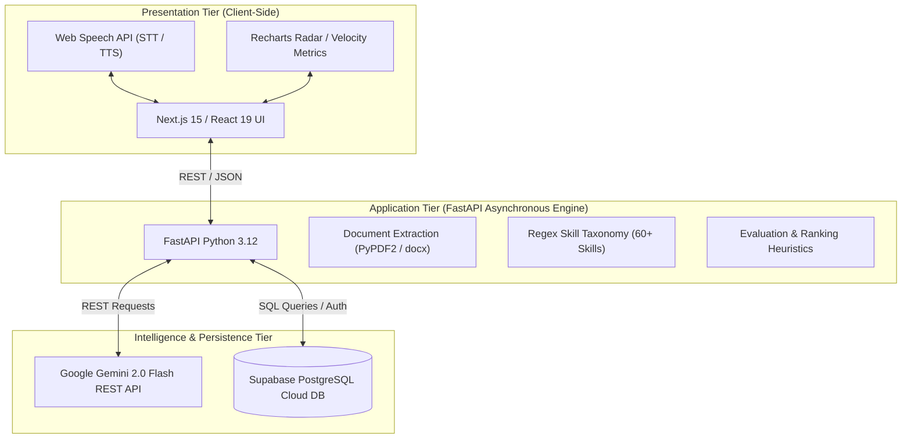

# 🚀 HireAI — Autonomous AI-Powered Talent Screening & Evaluation Platform

[](https://nextjs.org/)
[](https://fastapi.tiangolo.com/)
[](https://ai.google.dev/)
[](https://supabase.com/)
[](https://tailwindcss.com/)
[](https://opensource.org/licenses/MIT)

> **HireAI** is an enterprise-grade autonomous recruitment platform that transforms traditional resume screening into an intelligent, objective, two-tier evaluation system. Powered by Google Gemini 2.0 Flash, FastAPI, Next.js 15, and browser-native Speech-to-Text, HireAI automates resume parsing, skill matching, voice-based technical interviews, and multi-dimensional radar scoring.

---

## 🌟 Key Highlights & Features

- **🧠 Intelligent Resume Parsing**: High-throughput extraction of candidate education, experience, and 60+ technical skills from PDF and DOCX documents with strict regex taxonomy constraints to eliminate hallucinations.
- **🎙️ Autonomous Technical Voice Interview Room**: Interactive real-time audio interview simulation utilizing the Web Speech API (STT), automatic countdown timers, and client-side SpeechSynthesis.
- **📊 6-Dimensional Radar Evaluation Scorecard**: Multi-criteria performance assessment covering *Technical Depth, Problem Solving, Communication Clarity, Architectural Vision, Practical Experience,* and *Adaptability*.
- **⚡ Semantic Job Recommendation Engine**: Jaccard and Cosine similarity scoring matching parsed candidate competencies against recruiter job requisitions.
- **📂 Bulk Batch Screening**: Recruiter modal supporting parallel upload and evaluation of dozens of candidate resumes simultaneously.
- **🎭 Dual-Persona Authentication**: Dedicated role-based portals for **Candidates** (5-step job application journey) and **Employers** (requisitions, candidate pool, analytics).
- **🎨 Interactive 3D Mascot UI**: Immersive dark/light interface built with Framer Motion and Lucide icons.

---

## 🏗️ System Architecture

HireAI is architected as an asynchronous, decoupled 3-tier system:



---

## 🛠️ Tech Stack

| Component | Technology | Version | Purpose |
| :--- | :--- | :--- | :--- |
| **Frontend Framework** | Next.js (App Router) | 15.0+ | Server-side rendering, client components & routing |
| **UI Library** | React | 19.0+ | Reactive state management & hooks |
| **Styling & Animation** | Tailwind CSS / Framer Motion | 3.4+ / 11+ | Enterprise dark mode UI & smooth animations |
| **Data Visualization** | Recharts / Lucide React | 2.13+ | Radar scorecards & application velocity charts |
| **Backend Framework** | FastAPI (ASGI / Uvicorn) | 0.115+ | High-throughput asynchronous REST microservices |
| **Language Runtime** | Python | 3.12+ | Document parsing, regex taxonomy, and AI grading |
| **LLM Engine** | Google Gemini 2.0 Flash | REST API | Question generation, answer grading, and diagnostics |
| **Document Processing** | PyPDF2 & python-docx | 3.0+ / 1.1+ | Extraction of raw text from PDF & Word resumes |
| **Database & Auth** | Supabase (PostgreSQL) | v2 Cloud | Relational tables, JWT authentication, and grants |

---

## 🚀 Quick Start Guide

### Prerequisites
- Node.js (v18.17 or higher)
- Python (v3.10 to v3.12)
- Supabase Account & Google Gemini API Key

---

### Step 1: Clone Repository
```bash
git clone https://github.com/<your-username>/hireai.git
cd hireai
```

---

### Step 2: Configure Environment Variables

1. **Frontend Configuration**:
   ```bash
   cp frontend/.env.local.example frontend/.env.local
   ```
   Fill in your Supabase credentials:
   ```env
   NEXT_PUBLIC_SUPABASE_URL=https://your-project.supabase.co
   NEXT_PUBLIC_SUPABASE_ANON_KEY=your_supabase_anon_key
   NEXT_PUBLIC_API_URL=http://localhost:8000
   ```

2. **Backend Configuration**:
   ```bash
   cp backend/.env.example backend/.env
   ```
   Fill in your Gemini and Supabase credentials:
   ```env
   GEMINI_API_KEY=your_gemini_api_key
   SUPABASE_URL=https://your-project.supabase.co
   SUPABASE_SERVICE_KEY=your_supabase_service_role_key
   SECRET_KEY=your_random_jwt_secret
   ```

---

### Step 3: Install Dependencies & Run

#### Option A: Quick 1-Click Launch (Windows)
Simply double-click:
```cmd
START_HIREAI.bat
```
This batch script will automatically:
1. Activate Python virtual environment and start FastAPI on `http://localhost:8000`
2. Start Next.js on `http://localhost:3000`
3. Launch your default browser to `http://localhost:3000`

---

#### Option B: Manual Terminal Execution

**Terminal 1 — Backend**:
```bash
cd backend
python -m venv venv
# On Windows:
.\venv\Scripts\activate
# On Linux/macOS:
source venv/bin/activate

pip install -r requirements.txt
uvicorn main:app --reload --port 8000
```

**Terminal 2 — Frontend**:
```bash
cd frontend
npm install
npm run dev
```

Open your browser at **`http://localhost:3000`**.

---

## 📑 College Project Report & Documentation
The complete **B.Tech Mini Project Report (32 Pages, IEEE Format)** covering theoretical background, mathematical formulation, testing results, and system diagrams is compiled in the `project_report/` directory.

---

## 📜 License
This project is licensed under the [MIT License](LICENSE).
